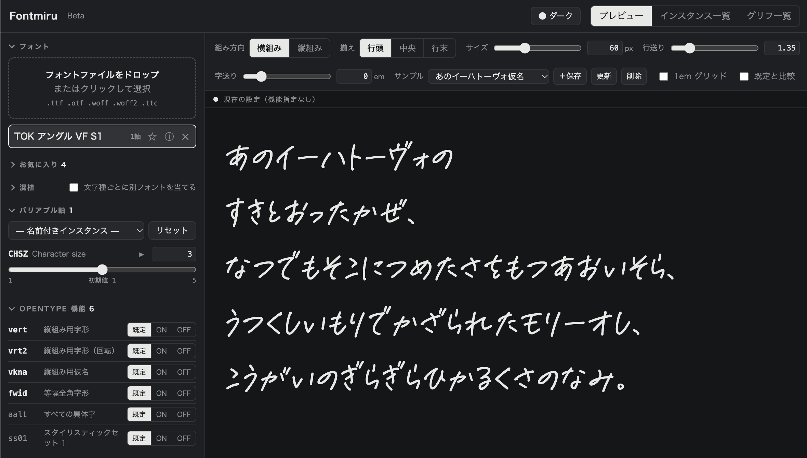

日本語/[English](README.md)

# Fontmiru

フォントファイルを読み込んで、組見本・OpenType 機能・バリアブル軸・収録グリフ・内部テーブルを確認できる、ブラウザベースのフォント検証ツールです。

和文フォントの検証を重視しており、**縦組み** や **和文の詰め（`palt` / `vpal` などのプロポーショナルメトリクス）** の効き具合も確認できます。フォントの解析はすべてブラウザ内で完結し、ファイルが端末の外に送信されることはありません。

  

## Live Demo

[https://toktaro.github.io/Fontmiru/](https://toktaro.github.io/Fontmiru/)

## 機能

### 組見本（プレビュー）

- **横組み／縦組み**: ワンクリックで切り替え。縦組みでは `vert` 字形や欧文の向き（`text-orientation`）も確認可能
- **OpenType 機能の切り替え**: フォントが持つ機能を自動で一覧化し、「既定 / ON / OFF」の三段階で切り替え。和文系の機能（`palt` `vpal` `pkna` `kern` `vkrn` `halt` `vhal` `chws` ほか）を優先表示
- **既定と比較**: 機能を適用した状態と適用しない状態を並べて表示
- **1em グリッド**: 詰めによる字送りの変化を升目とのズレで確認
- **組版の調整**: サイズ・行送り・字送りをスライダーと数値で指定、揃え（行頭／中央／行末）の切り替え
- **サンプルテキスト**: 約物・かな・和欧混植などのプリセットに加え、編集したテキストを「マイサンプル」として保存
- **混植**: 選択中のフォントをベースに、文字種（漢字／ひらがな／カタカナ／約物・記号／欧文／数字）ごとに別のフォントを当てて表示（例: かなフォント ＋ 別フォントの漢字）。文字種ごとのサイズ比率も指定可能

### バリアブルフォント

- **軸の操作**: `fvar` を解析し、軸ごとのスライダーと数値入力で調整
- **名前付きインスタンス**: 一覧から選択して適用、全インスタンスを並べて表示するビューも用意
- **アニメーション**: 軸ごとに値を自動で往復させて変化を確認

### グリフ一覧

- **収録文字の一覧**: `cmap` を解析してグリッド表示（グリフ名は `post` テーブルから取得）
- **絞り込み・検索**: Unicode ブロック、文字、`U+XXXX`、グリフ名で検索
- **書き出し**: 収録文字をクリップボードにコピー、ブロック別の `.txt`、BOM 付き `.csv` で保存
- **グリフのメトリクス**: ダブルクリックで、送り幅・サイドベアリング（LSB / RSB、縦組みの TSB / BSB）・縦原点（`VORG`）・バウンディングボックスを図解つきで表示

### フォント情報・テーブル

- **フォント情報**: `name` テーブルの主要項目、メトリクス（`OS/2` / `head` / `hhea` / `vhea`）などを一覧表示
- **制作者・ライセンス**: 製造者・デザイナー（各 URL）、Vendor ID、著作権、商標、ライセンス本文・URL、埋め込み許可（fsType）をまとめて確認
- **テーブル一覧**: 主要テーブル（`head` `hhea` `vhea` `maxp` `post` `OS/2` `name` `cmap` `fvar` `GDEF` `GSUB` `GPOS`）の解析値を表示。未対応のテーブルは先頭部分を 16 進数で表示
- **GDEF のバージョン**: majorVersion / minorVersion の値をそのまま表示するため、フォントエディタの書き出し結果の検証にも使えます
- **仕様ページへのリンク**: 各テーブルの ⓘ から、Microsoft OpenType 仕様（AAT 系は Apple TrueType Reference Manual）を開けます

### 便利な機能

- **お気に入り**: よく使うフォントを ☆ で登録すると、次回からサイドバーのお気に入り一覧をクリックするだけで開けます。同じファイル名で内容が異なるフォントを読み込んだ場合は、保存されている版を更新できます
- **テーマ**: OS 設定に合わせる／ライト／ダークを切り替え
- **折りたたみ**: サイドバーの各項目は見出しのクリックで折りたため、開閉状態は次回も保持されます
- **完全ローカル処理**: すべてブラウザ内で完結し、フォントファイルがサーバーに送信されることはありません

## 使い方

### 基本的な流れ

1. `index.html` をブラウザで開く（または Live Demo にアクセス）
2. 左のパネルにフォントファイルをドロップ、またはクリックして選択（複数可）
3. 「プレビュー」で組見本を確認し、組み方向・OpenType 機能・バリアブル軸などを切り替える
4. 「グリフ一覧」で収録文字を、ⓘ ボタンからフォント情報・テーブルを確認する

### 混植を試すには

1. ベースにしたいフォント（例: かなフォント）と、組み合わせたいフォント（例: 漢字のフォント）を読み込む
2. フォント一覧でベースのフォントを選択する
3. サイドバーの「混植」にチェックを入れ、文字種ごとに当てるフォントとサイズ比率を指定する

### お気に入りについて

ブラウザはファイルの保存場所から自動で読み込み直すことができないため、お気に入りに登録したフォントは、ファイルの複製をブラウザ内（IndexedDB）に保存します。保存先はブラウザごと・アクセスした URL ごとに分かれます。お気に入りから外すと、保存した複製も削除されます。

## 技術仕様

- **動作環境**: モダンブラウザ（Chrome, Safari 推奨。Firefox, Edge でも動作）
- **依存関係**: なし（外部ライブラリ・CDN は使用していません）
- **ファイル形式**: 単一 HTML ファイル（CSS・JavaScript 埋め込み）

### 対応フォーマット

| 形式 | 表示 | 解析（軸・機能・グリフ・テーブル） |
|------|------|------|
| TTF / OTF | ○ | ○ |
| TTC / OTC | ○（全フェイスを展開） | ○ |
| WOFF | ○ | ○ |
| WOFF2 | ○ | ×（表示のみ） |

### 既知の制限

- グリフ一覧に表示されるのは、文字コードが割り当てられたグリフのみです（`vert` 用の字形など、文字コードを持たないグリフは表示できません）
- 詰め・カーニングの表示結果は、ブラウザの文字組み処理に依存します
- グリフのメトリクスは既定インスタンスの値です（バリアブルフォントの変化量は反映されません）。CFF アウトラインのフォントでは、バウンディングボックスはブラウザでの実測による概算値です
- 混植は文字単位で切り替えるため、異なるフォントの文字どうしのカーニングや、前後の文字に依存する OpenType 機能は効きません。サイズ比率はベースラインを基準に拡大縮小します
- `cmap` は format 4 / 12 に対応しています

## ライセンス

このプロジェクトは [MIT License](LICENSE.md) の下でライセンスされています。

個人・商用を問わず自由にお使いいただけます。改変して公開される場合は、できればソースも公開していただけると嬉しいです（義務ではありません）。

本ツールは現在テスト開発中（Beta）のものであり、表示内容や解析結果の正確性を保証するものではありません。本ツールの使用によって生じたいかなる損害についても保証いたしかねます。

読み込むフォントファイルの扱いは、各フォントのライセンスに従ってください。

(c) 2026- toktaro
